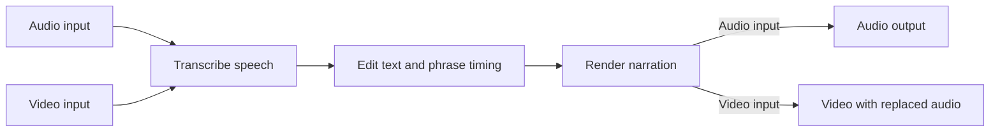

# Voiceover

Replace the narration in an audio or video recording while keeping the original phrase timing.



## Install on Linux

Install FFmpeg, eSpeak NG, and Python 3.11 or 3.12 with `venv`. From the cloned repo, run:

```sh
python3 -m venv .venv
.venv/bin/python -m pip install -r requirements.txt
```

The first run downloads the Whisper and Kokoro models. Both run on CPU by default.

## Use it

```sh
./start.sh "Tutorial.mp4"
```

1. Open the local review link printed in the terminal.
2. Correct the transcript or adjust phrase timings. Edits save to `Tutorial.transcript.json` beside the recording.
3. Click **Render video** or **Render audio**. For `Tutorial.mp4`, this creates `Tutorial.out.mp4`. Press **Ctrl+C** in the terminal when you’re done.

Voiceover supports MP4, MOV, MKV, WebM, WAV, MP3, and M4A. For video, it keeps the picture and subtitles and replaces the audio, including any music or effects in the original track.

## Skip review

```sh
./start.sh "Tutorial.mp4" --no-review --voice af_bella
```

Add `--overwrite` to replace an existing output. Run `.venv/bin/python voiceover.py dub --help` for all options.
